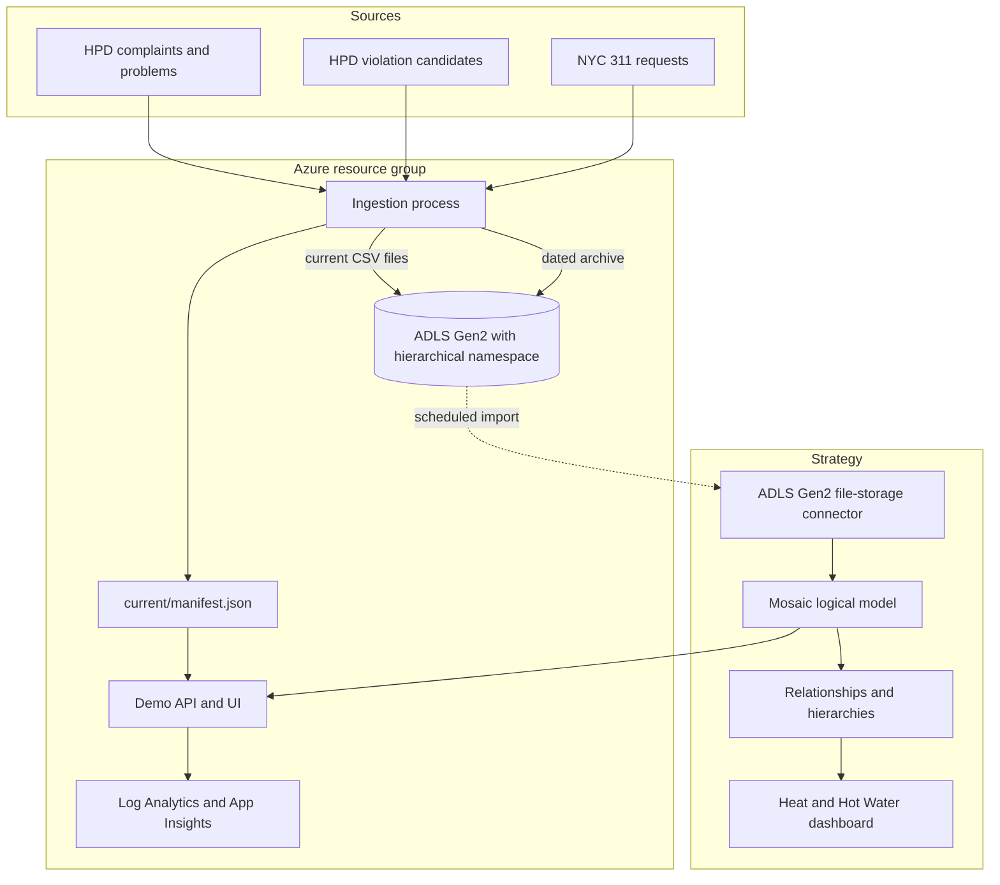
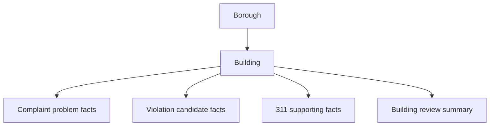
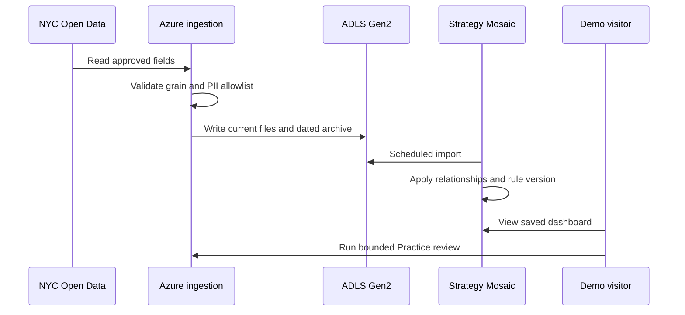

# Architecture and process diagram

## Data path

Solid arrows show internal data movement. The dashed ADLS-to-Strategy line is a
scheduled import. Strategy does not query Blob Storage for every visitor request.

## Mosaic logical model

`building_id` is the shared key. Complaint problems can appear more than once
for one complaint, so the model must count distinct `complaint_id`.

## Operational sequence

