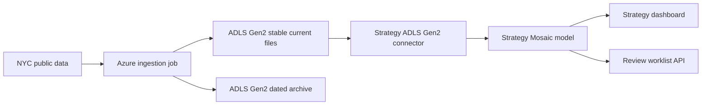

# Architecture overview

The demo helps a supervisor review building records without assembling the
sources, definitions, and guidance by hand.

## Strategy-first data path

ADLS Gen2 is built on Blob Storage and provides a hierarchical namespace.
Strategy imports CSV files through its Azure Data Lake Storage Gen2 file-storage
connector. Strategy owns the relationships, attributes, measures, and
hierarchies.

## Why these parts are separate

The Azure ingestion job reads each source at its original grain. It writes:

- complaint problems;
- candidate violations;
- supporting 311 requests;
- a building-level summary; and
- a process manifest.

Strategy maps `building_id` and creates the business view. The app reads the
process manifest and the approved review result. It does not access raw Blob
Storage data from the browser.

## Refresh

The file layout keeps stable current paths, one Strategy folder per table, and
immutable dated archives. Strategy's Daily refresh replaces data from the
`strategy-*` folders. The archive preserves the evidence for each run.

## Current status

The deployment creates an ADLS Gen2 account and the `heat-hot-water` container.
Resource names stay in the authorized Azure deployment. Current files and a
dated archive are present.

The app uses managed identity. Shared-key storage authentication is disabled
in the public Bicep deployment. Any external Strategy connection is configured
outside this repository.

